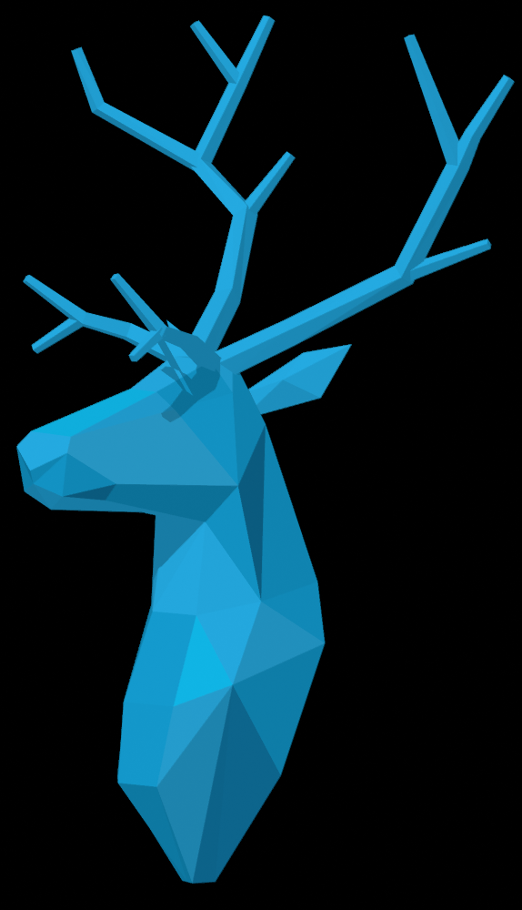

# Vaadin reindeer reconstruction

An editable, deliberately low-poly reindeer head and neck for web animation and 3D printing. The current model is **V21**, authored in **Blender 5.3.0 Beta**.



| Path | Purpose |
| --- | --- |
| `model/reindeer.blend` | Self-contained editable master: five meshes, head/neck rig, two cameras |
| `reference/` | Original artwork, repaired volume reference and annotated targets |
| `scripts/export.py` | Portable GLB/STL export and geometry checks |
| `exports/` | One current set of convenient derivatives and validation results |
| `docs/model-notes.md` | Modeling decisions and remaining work |
| `web/` | Browser motion lab: logo-matched shading, gaze, voice-driven talking, ASCII (see `web/README.md`) |
| `site/` | Static share page: pose presets, pointer following, ASCII, downloads, STL export of the current pose (see `site/README.md`) |

## Open and edit

Open `model/reindeer.blend` in Blender. `Reindeer.Rig` has two custom properties: `head_yaw_deg` (19) and `head_pitch_deg` (15, upward), which together give the logo pose. Set both to 0 for the neutral pose, level and straight ahead. Ears and antlers follow the head. The logo camera is fitted independently from the head turn; the overview camera has more room for animation.

The master contains broad, flat facets and editable quads. Each STL joins the five mesh volumes into one closed component; the GLB retains the rig and a short head-turn animation.

## Re-export on another machine

Blender is the only dependency. Use the same Blender version initially; no MCP server or separate Python environment is needed. From the repository root:

```sh
blender --background model/reindeer.blend --python-exit-code 1 --python scripts/export.py
```

On macOS, if Blender is not on your PATH:

```sh
"/Applications/Blender.app/Contents/MacOS/Blender" \
  --background model/reindeer.blend \
  --python-exit-code 1 --python scripts/export.py
```

This regenerates `exports/reindeer.glb`, `exports/reindeer-normalized.stl` (logo pose), `exports/reindeer-straight-normalized.stl` (neutral pose) and `exports/validation.json`. The exporter does not save or overwrite the master. To use a different output directory, append `-- --output-dir /path/to/output`.

The STLs use normalized design coordinates. Intended print height, material, process and minimum antler thickness are still undecided; set a physical scale before slicing. A 3MF with physical units can follow that decision. Mesh checks do not establish print strength.

## Versioning

Keep stable filenames and let Git track revisions. Only the latest exports are committed. Earlier local iterations in `work/`, renders in `renders/`, the supplied handoff folder and Blender backup files are ignored and remain on disk. These current files are small enough for ordinary Git.

The original artwork and volume reference were supplied for this project. No additional license has been selected for the repository.
